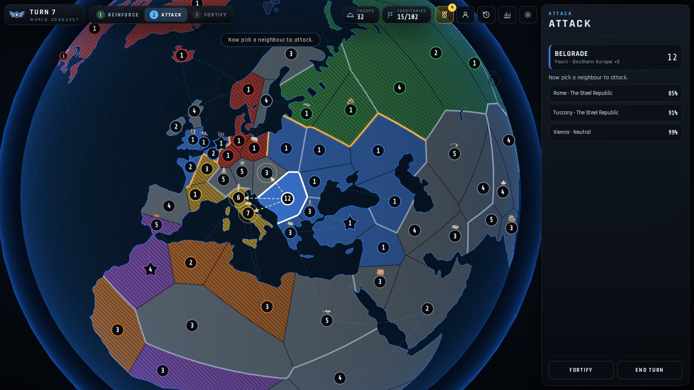
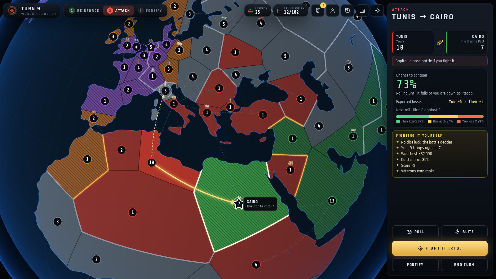
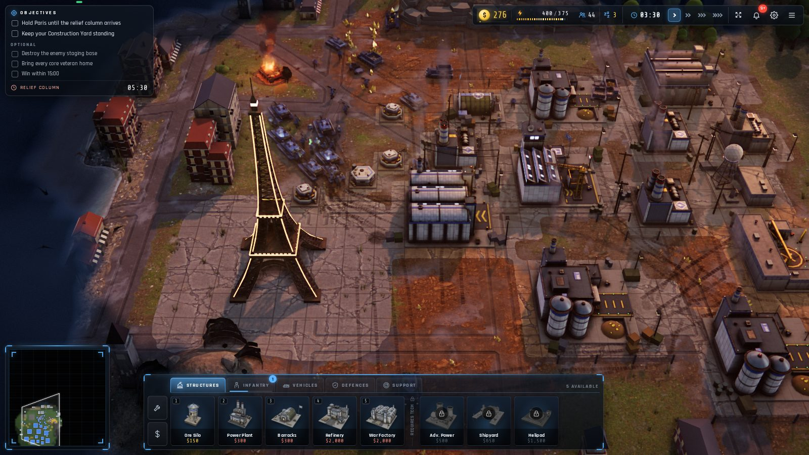
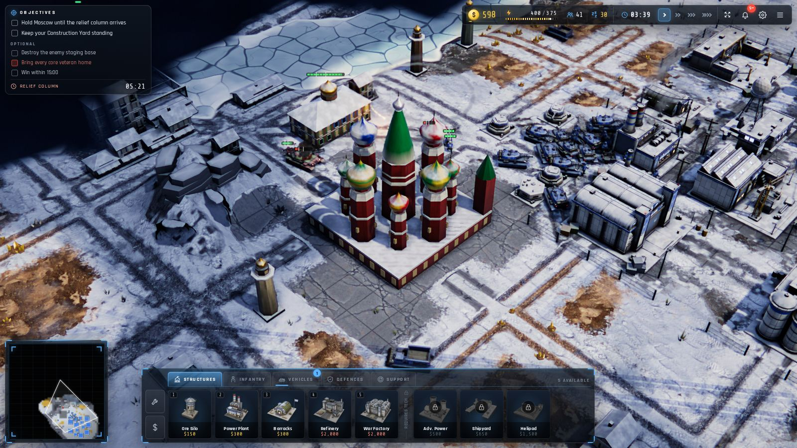
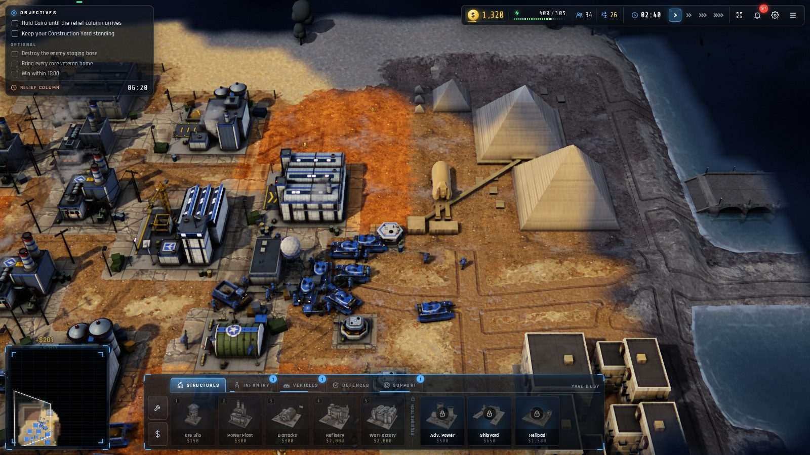
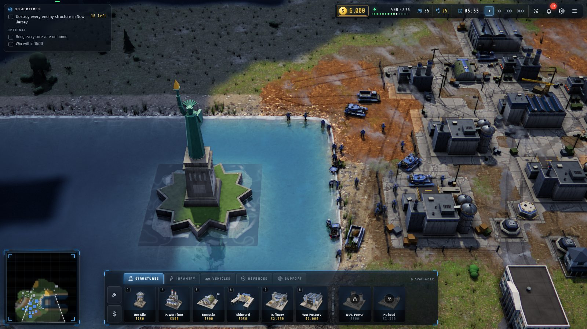

<div align="center">

# Red Horizon

**The gameplay of *Command & Conquer: Red Alert* (1996), rebuilt for the browser in modern real-time 3D.**

[](https://github.com/islamdiaa/red-horizon/actions/workflows/ci.yml)
[](LICENSE.md)


</div>

Allies against Soviets: bases, ore, power and tech trees, Tesla Coils and Mammoth Tanks, navies, spies,
Chronospheres and nukes. Red Horizon is a clean-room TypeScript and three.js engine built on the original rules that
EA released under the GPL. It runs in any modern browser, with nothing to install and no account. It ships no
copyrighted assets: every model, texture, sound and piece of music is generated by code in this repository or baked
from public-domain (CC0) inputs.

| | |
|---|---|
|  |  |
|  |  |
|  |  |
|  |  |
|  |  |

## Why I built this

Red Alert is one of the games I grew up with, and I wanted it back as something you can open in a browser and play,
looking like a game made today rather than in 1996. It was also an experiment: how far can today's AI coding tools
take a large, real project if you give them a clear direction and a high bar? And it was a way to learn the parts of
game development I find fascinating (deterministic simulation, rendering, AI opponents and netcode) while having fun.

It's a non-commercial hobby project with a few rules I set from the start: stay faithful to the original, use no
copyrighted assets, and respect the player (no accounts, tracking, ads or dark patterns).

## Highlights

- **World Conquest, a Risk-style world campaign.**
  - Start from any of 44 homelands and take the world on a 3D globe: over 100 territories in 18 bonus zones, or a
    shorter Blitz around your home.
  - Risk rules: reinforce, attack and fortify, with cards and zone bonuses.
  - Every attack is your choice: roll the dice, with the odds shown first, or **fight it as a real-time battle**.
  - Each battlefield is generated to look like the place: its climate, terrain, towns in the local architecture, and
    its landmark, from the Eiffel Tower to the pyramids. All 37 landmarks are modelled in code.
  - 3–5 rival empires with their own personalities, ceasefires and betrayals.
  - Challenge links, a Weekly World and a share card.
- **Faithful Red Alert gameplay.**
  - 43 unit types and 38 structures, including the expansion units.
  - The original `RULES.INI` values and damage formula.
- **Lots to play.**
  - Two campaigns and Boot Camp.
  - Special operations and co-op survival.
  - Europe Conquest, a roguelite campaign.
  - Daily challenges.
  - Replays you can take command of.
- **Skirmish with depth.**
  - *Classic* rules are pure Red Alert.
  - *Commander* rules add an economy that evolves, doctrines, commander powers, battlefield events, capturable tech
    and 24 mutators.
- **Multiplayer.** Online matches for up to 4 players through a small relay you host yourself. Leaderboards verify every
  score by replaying the run.
- **Looks the part.**
  - HD models and animated HD infantry that hold up in crowds of hundreds.
  - Weather and a day-night cycle.
  - Dynamic lights, GPU particles and physics destruction.
  - Adaptive music.
- **Smart AI.** It plays under fog of war, counters your army, and has 11 personalities and five difficulty levels,
  measured against scripted human stand-ins.
- **Make your own.** A map and mission editor, and JSON rule mods.
- **Plays anywhere.**
  - Mouse, touch or gamepad.
  - Installs as an offline-capable app.
  - Seven languages: English, Русский, Deutsch, Español, Português (Brasil), Français and 简体中文.

## Quick start

```bash
git clone https://github.com/islamdiaa/red-horizon.git && cd red-horizon
npm ci
npm run dev                       # http://localhost:5173
```

Or with Docker:

```bash
docker compose up -d --build      # http://localhost:8091 (game + multiplayer relay)
```

`npm run build` writes a static site to `dist/` that you can host anywhere; a `vercel.json` is included. You need
Node.js 20.19+ (or 22.12+) and a browser with WebGL 2. On a static host without the multiplayer relay,
`VITE_MULTIPLAYER=off npm run build` removes online play from the game entirely
([details](docs/MULTIPLAYER.md#turning-online-play-off)).

## Under the hood

- **Deterministic simulation.**
  - A fixed 20 Hz simulation (`src/sim`) with a seeded RNG and portable maths, kept separate from rendering.
  - The same inputs give bit-identical games, which powers replays, lockstep multiplayer, save/load and server-side
    score verification.
- **Rendering.**
  - three.js on WebGL 2.
  - Physically based materials and dynamic lights.
  - Temporal anti-aliasing with dynamic resolution.
  - Low, Medium and High presets, tuned on a real integrated GPU.
- **Assets from code.**
  - Procedural models, effects, sounds and music.
  - A headless-Blender "asset factory" (`tools/assets`) bakes the HD models and terrain from CC0 inputs.
  - World Conquest's landmarks and towns are built at runtime from a small modelling kit.
- **Small dependency footprint.** The game's only runtime dependency is three.js; the relay's is `ws`.
- **Tested heavily.**
  - About 1,400 unit and integration tests.
  - Headless self-play to measure AI difficulty.
  - Campaign autopilots.
  - Determinism and save/load checks.
  - A browser bot that plays every mode through the real UI.
  - A real-GPU screenshot rig and cross-browser runs.

```
src/
  sim/        deterministic game simulation: units, economy, pathfinding, AI, map generation
  render/     three.js renderer: terrain, models, effects, weather, landmarks and towns
  ui/         menus, HUD and the World Conquest screens
  conquest/   Europe and World Conquest campaigns (pure, deterministic strategy layers)
  missions/   campaign and special-operation scripts
  net/        lockstep multiplayer client      (server/ holds the relay and leaderboards)
  audio/      procedural sound effects, music and speech
  i18n/       translations for seven languages
tests/        node:test suites
tools/        headless harnesses, self-play, UI bot, GPU rig, asset factory (see tools/README.md)
docs/         player and developer documentation
```

## Documentation

- [Playing](docs/PLAYING.md): modes (World Conquest included), Commander rules, progression, controls, the editor and
  mods, and fidelity to Red Alert.
- [Development](docs/DEVELOPMENT.md): architecture, testing, the HD model factory, deployment and test URL parameters.
- [Balance](docs/BALANCE.md): how difficulty and balance are measured, with the numbers.
- [Multiplayer](docs/MULTIPLAYER.md): online matches, verified leaderboards, and hosting the relay.
- [Distribution](docs/DISTRIBUTION.md): itch.io, desktop builds, Vercel and share links.
- [Tools](tools/README.md): every harness and script.
- [Contributing](CONTRIBUTING.md) · [Security](SECURITY.md)

## Privacy and security

- The game is a static site. It has no accounts, no analytics, no cookies and makes no third-party requests.
- Saves and settings stay in your browser.
- Imported files and share links are treated as untrusted. One hardened parser validates them, and they are never
  run as code or HTML.
- The shipped nginx and Vercel configurations send a strict Content-Security-Policy (same-origin only, no inline or
  `eval`'d script) and the usual security headers. The containers run unprivileged with read-only filesystems.
- Multiplayer and the leaderboards are optional and run on a relay you host. It keeps no accounts or personal data
  ([details](docs/MULTIPLAYER.md#privacy-and-security)).

Found a vulnerability? Please report it privately, as described in [SECURITY.md](SECURITY.md).

## License and legal

- **License:** [GNU GPL v3.0 or later](LICENSE.md). The game rules are derived from EA's GPL release of the Red Alert
  source code.
- **Trademarks:** *Command & Conquer* and *Red Alert* are trademarks of Electronic Arts Inc. This is a non-commercial
  fan project, **not affiliated with or endorsed by Electronic Arts**. It contains no EA art, audio or video.
- **Third-party inputs:**
  - **Textures:** HD models and terrain materials are baked from [Poly Haven](https://polyhaven.com/) scans (CC0). The
    raw inputs aren't in the repository; `tools/assets` fetches the pinned files.
  - **Map data:** World Conquest's coastlines and lakes come from [Natural Earth](https://www.naturalearthdata.com/)
    1:110m (public domain).
  - **Fonts:** the bundled fonts use the [SIL Open Font License](public/fonts/OFL.txt).
- **Landmarks and places:** they appear as scenery in an alternate 1953. Territories are named after cities and
  regions, and no modern borders are drawn.

## Acknowledgements

Westwood Studios for the original game, Electronic Arts for releasing its source code, and the people behind
[three.js](https://threejs.org/), [Blender](https://www.blender.org/), [Poly Haven](https://polyhaven.com/) and
[Natural Earth](https://www.naturalearthdata.com/).

Built with [Claude Code](https://claude.com/claude-code).
