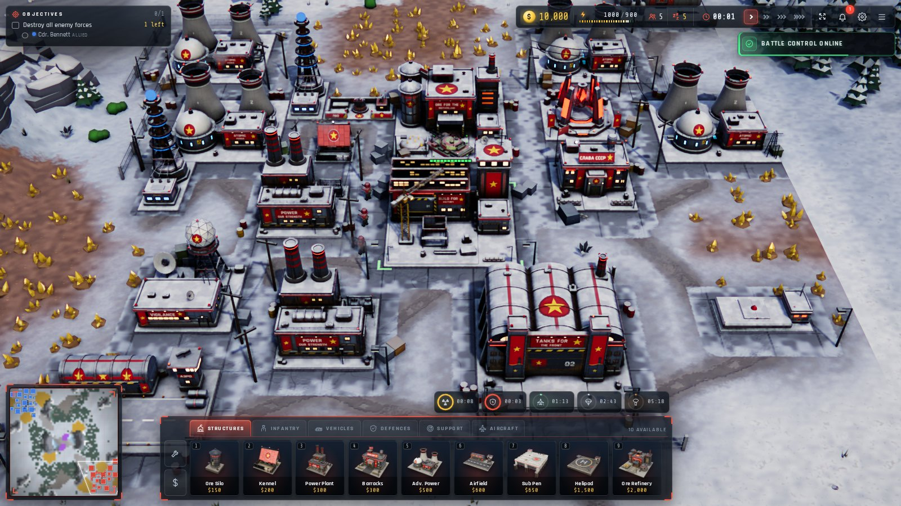
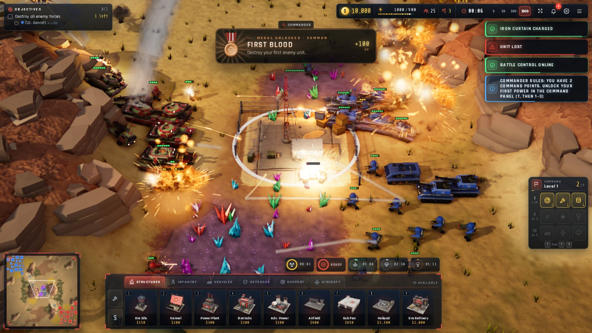
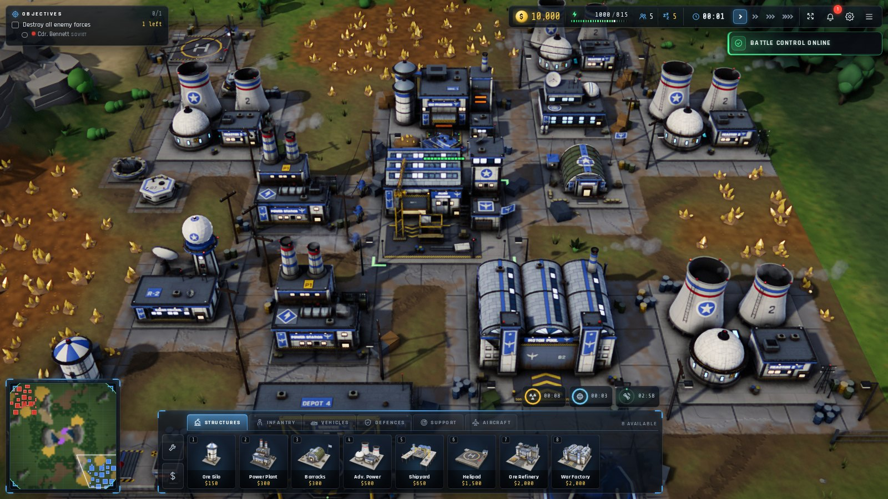
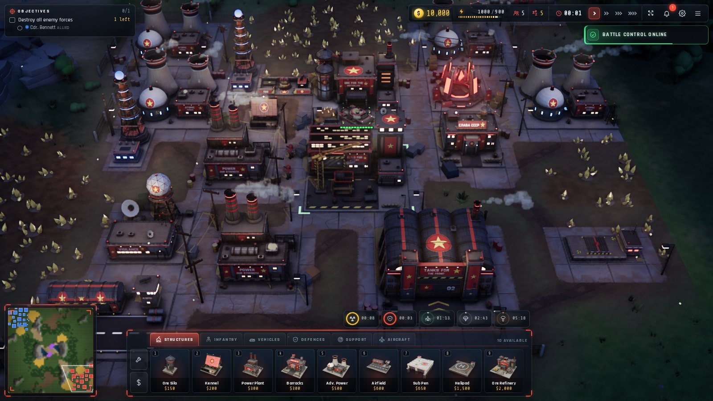
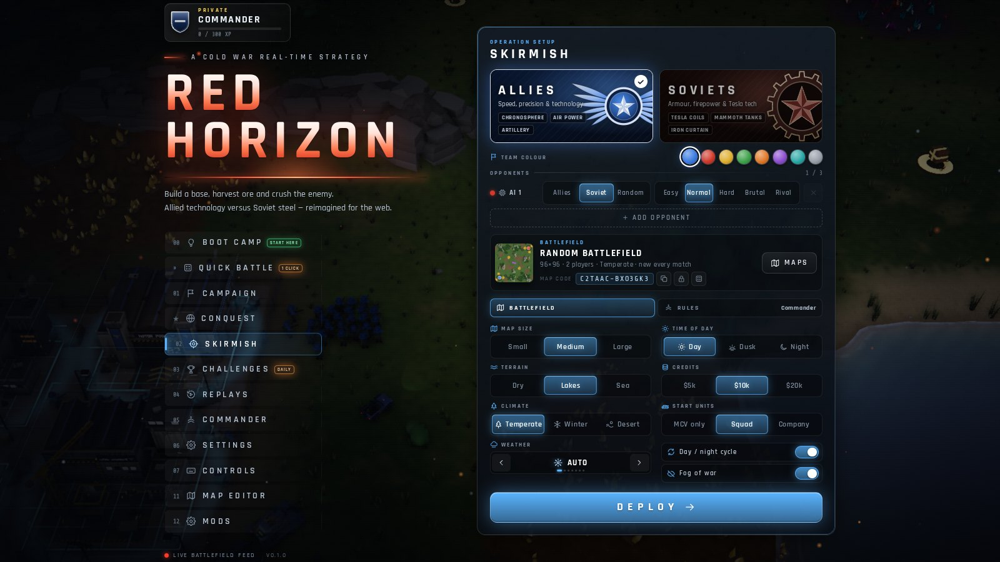
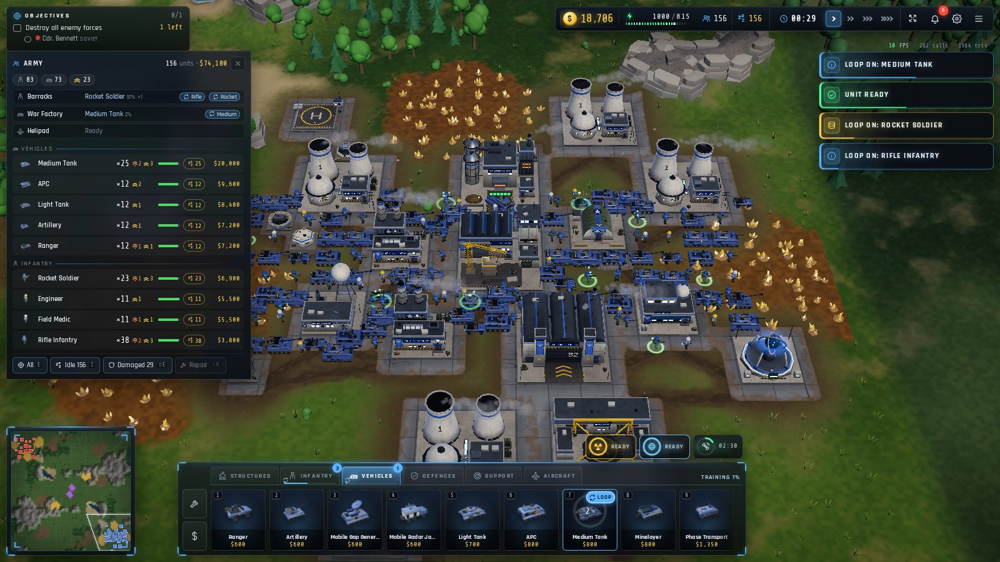

# Red Horizon

**The gameplay of *Command & Conquer: Red Alert* (1996), rebuilt for the browser in modern
real-time 3D.**

Allies against Soviets: bases, ore, power and tech trees, Tesla Coils and Mammoth Tanks, navies,
spies, Chronospheres and nukes. It's a clean-room TypeScript and three.js engine built on the
original rules that EA released under the GPL. Every model, texture, sound and piece of music is
generated by code in this repository, so it ships **no copyrighted assets**. There's nothing to
install and no account.

| | |
|---|---|
|  |  |
|  |  |
|  |  |

## Highlights

- **Faithful Red Alert gameplay.**
  - 43 unit types and 38 structures, including the expansion units.
  - The original `RULES.INI` values and damage formula.
- **Lots to play.**
  - Two campaigns and Boot Camp.
  - Special operations and co-op survival.
  - Conquest, a roguelite campaign.
  - Daily challenges.
  - Replays you can take command of.
- **Skirmish with depth.**
  - *Commander* rules:
    - an economy that evolves: Construction Yard tiers, visible building upgrades, research, and
      new buildings (mining outposts, bunkers, gates);
    - doctrines, commander powers, battlefield events, capturable tech and 24 mutators.
  - *Classic* rules: pure Red Alert.
- **Multiplayer.** Online matches for up to 4 players, through a small relay you host yourself.
  Leaderboards verify every score by replaying the run.
- **Reasons to come back.**
  - Ranks, medals, and daily and weekly contracts.
  - Earned cosmetic unlocks.
  - A results screen with battle charts and one-key *Play again*.
- **Looks the part.**
  - HD texture-baked models, and HD infantry with real animation that holds up in crowds of hundreds.
  - Scanned terrain materials and roads.
  - Dynamic lights, GPU particles and heat haze; battle scars that persist.
  - Weather, a day-night cycle and physics destruction.
  - Adaptive music.
- **Smart AI.**
  - It plays under fog of war and counters your army.
  - 11 personalities, and rivals that remember you.
- **Make your own.** A map and mission editor, and JSON rule mods.
- **Plays anywhere.** Mouse, touch or gamepad. It installs as an offline-capable app; HD content
  downloads when a battle needs it, or all at once for offline play from Settings.
- **Speaks your language.** English, Русский, Deutsch, Español, Português (Brasil), Français and 简体中文.
  It follows the browser, or you pick one in Settings.

## Quick start

```bash
git clone https://github.com/islamdiaa/red-horizon.git && cd red-horizon
npm ci
npm run dev                       # http://localhost:5173
```

Or run it in Docker:

```bash
docker compose up -d --build      # http://localhost:8091
```

`npm run build` produces static files in `dist/`, which you can host anywhere. A `vercel.json` is
included. You need Node.js 20.19+ and a WebGL 2 browser.

## Documentation

- [Playing](docs/PLAYING.md): modes, Commander rules, progression, controls, editor and mods,
  and fidelity to Red Alert.
- [Development](docs/DEVELOPMENT.md): architecture, testing, the HD model factory, deployment,
  and test URL parameters.
- [Tools](tools/README.md): headless simulation, autopilots, self-play and screenshots.
- [Distribution](docs/DISTRIBUTION.md): itch.io, game portals, desktop builds, Vercel, link
  previews, share links, clips and the trailer.
- [Multiplayer](docs/MULTIPLAYER.md): online matches and verified leaderboards, and how to host the
  relay server.
- [Contributing](CONTRIBUTING.md) · [Security](SECURITY.md)

## Privacy and security

The game itself is a static site:
- no server, no accounts, no analytics, no cookies, and no third-party requests;
- saves and settings stay in your browser;
- imported files and share links are validated and never treated as code or HTML;
- share links carry their content after the `#`, which browsers never send to a server, and clips
  are recorded on your device;
- the shipped nginx and Vercel configurations send a strict Content-Security-Policy;
- multiplayer and the leaderboards are optional and use a relay server you host yourself. It keeps no
  accounts and no personal data: a callsign you choose is shown to your room and on the boards you
  submit to ([details](docs/MULTIPLAYER.md#privacy-and-security)).

## License and legal

- **License.** [GNU GPL v3.0 or later](LICENSE.md). The project is derived from studying EA's GPL
  release of the Red Alert source code.
- **Trademarks.** *Command & Conquer* and *Red Alert* are trademarks of Electronic Arts Inc. This
  project is **not affiliated with or endorsed by Electronic Arts**, and it contains no EA art,
  audio or video.
- **Fonts.** The bundled fonts are under the [SIL Open Font License](public/fonts/OFL.txt).
- **Build-time inputs.** The HD models are built with CC0 textures from
  [Poly Haven](https://polyhaven.com/) and the OFL font Russo One. Neither is distributed.

**Thanks to** Westwood Studios for the original game, Electronic Arts for releasing its source,
[three.js](https://threejs.org/), [Blender](https://www.blender.org/) and
[Poly Haven](https://polyhaven.com/).
